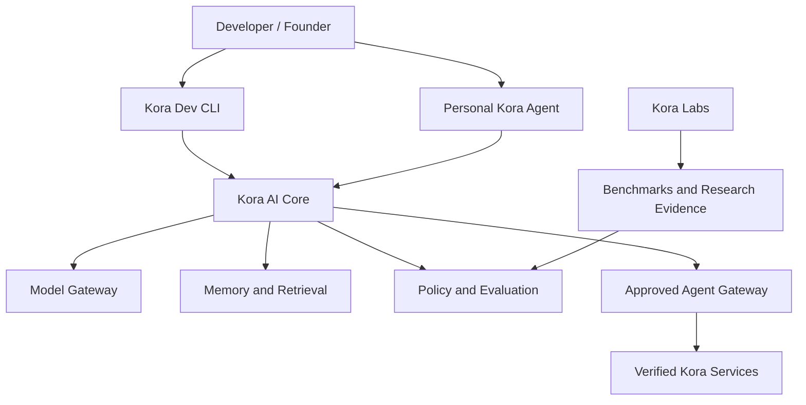

# Kora Mission, Technology Portfolio and AI Alignment

## Working mission — requires founder approval
**Build programmable, reliable, affordable infrastructure that enables developers and businesses to build, ship and operate software across fragmented, connectivity-constrained and resource-variable markets—starting in Africa and serving developers everywhere.**

This is a synthesis of Kora's existing planning documents, not a verified official corporate mission statement.

## Strategic pillars
1. **Infrastructure without assumptions:** intermittent connectivity, heterogeneous providers, cost constraints and data sovereignty are design inputs.
2. **Developer leverage:** Kora Dev provides a CLI-first path from code to production.
3. **Interoperability:** modular contracts and provider abstraction rather than closed integration silos.
4. **Trust:** secure defaults, evidence-backed architecture, auditable automation and recovery.
5. **Research to product:** Kora Labs tests hypotheses, produces reproducible evidence and transfers validated results to engineering.

## Proposed platform taxonomy
| Area | Mission role | Initial disposition |
|---|---|---|
| Kora Core | shared runtime/contracts | architecture evaluation |
| Kora Connect | provider abstraction and connectivity | validate demand and integrations |
| Kora Identity | identity and access capabilities | evaluate security/compliance first |
| Kora Finance | payments and transaction abstractions | regulated/high-risk: separate gating |
| Kora Sync / Edge | low-connectivity and edge resilience | research prototypes |
| Kora Cloud / Observe | deployment and operational visibility | integrate established providers first |
| Kora AI Core | model routing, retrieval, policy, memory, evaluations | proposed shared foundation |
| Kora Dev | CLI-first developer platform | first developer-facing product wedge |
| Kora Labs | research, benchmarks, RFCs and IP provenance | evidence and experiment governance |
| Personal Kora Agent | internal user of AI Core and Kora tools | narrow internal pilot |

**Do not interpret this taxonomy as a verified inventory of shipped products.**

## Architecture principle
Kora AI Core is a reusable capability layer; Kora Dev and the personal agent are separate clients. Identity, finance and regulated services must retain independent authorization and deployment boundaries.

## Product and research boundaries
- **Kora Technologies:** product strategy, engineering, customer commitments, security and releases.
- **Kora Labs:** hypothesis, datasets, methods, reproducible benchmarks, peer review and transfer criteria.
- **Kora Dev:** user experience and engineering automation, with runtime dependencies documented.
- **Personal Agent:** private internal application; no implied blanket permission to corporate systems.

## Open strategic questions
- What is Kora's first validated paying customer segment?
- Which modules are already real code versus research concepts?
- Which research is proprietary, open-source or third-party?
- Which infrastructure capability is the initial commercially defensible wedge?
