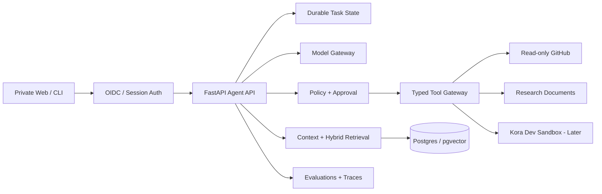
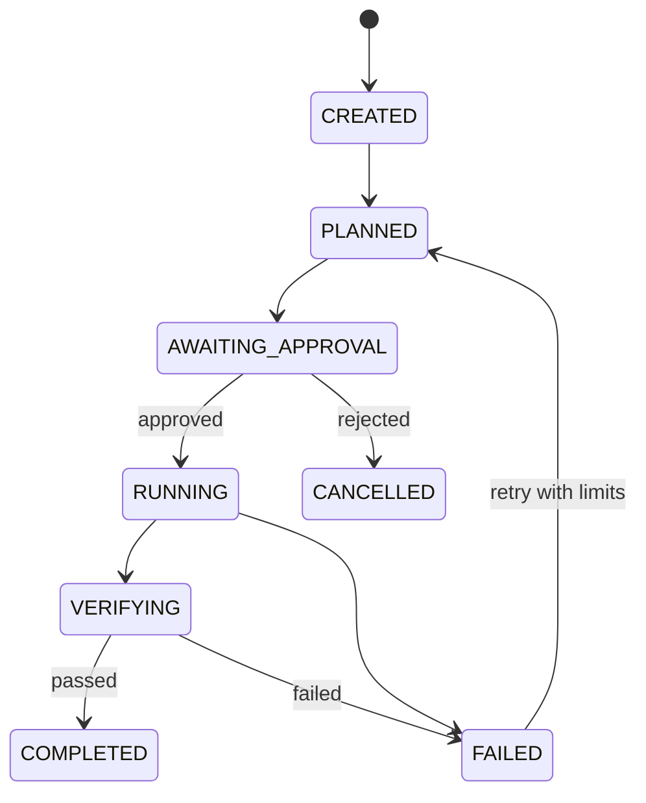

# Kora AI Core and Personal Agent — PRD + Architecture

## Problem
Kora's research, engineering, infrastructure and decision context are distributed. A personal agent should retrieve verifiable context and perform approved tasks without uncontrolled access.

## Users and jobs
**First user:** founder/technical operator. Jobs: daily engineering brief, source-grounded research synthesis, review of CI failures, architecture decision drafting, task planning. Secondary users later: Kora engineers and researchers.

## MVP in scope
- authenticated private chat and CLI interface;
- one hosted model through a provider-neutral gateway;
- read-only GitHub/research retrieval with file/commit provenance;
- session context and explicit persistent memory controls;
- typed tool registry and read-only agent gateway;
- task state machine with approval checkpoints;
- evaluation suite, cost and latency logs;
- generate engineering briefs and RFC/ADR drafts.

## Out of scope
Autonomous production deployment, financial transactions, arbitrary shell access, unrestricted email/calendar writes, unreviewed cross-project data sharing, voice avatar, proprietary foundation model, broad multi-agent swarms.

## Architecture

## Data contracts
- `Task`: id, owner, purpose, state, created_at, deadline, budget, approval_state.
- `Evidence`: source URI, commit/version, retrieved_at, classification, excerpt/hash.
- `Memory`: scope, consent, origin, expiry, deletion state, verification timestamp.
- `ToolInvocation`: actor, tool, arguments redacted, authorization, result, trace id.
- `Evaluation`: dataset version, run id, model, prompt version, pass/fail, latency, cost.

## Task state machine

## Recommended initial stack (subject to ADR)
FastAPI, Python, PostgreSQL + pgvector, SQLite for local-only experiments, one model API with adapter boundary, OpenTelemetry, GitHub App scoped read-only, pytest, Promptfoo/DeepEval or custom eval harness. Use managed secrets and OAuth/OIDC. Durable workflow options: Temporal, LangGraph persistence, or an explicit Postgres-backed state machine; select through tests.

## Security acceptance
- all external tools default read-only;
- user-approved, narrowly scoped writes;
- prompt injection tests from repository/docs content;
- no secrets or full source code in analytics;
- project- and role-scoped memory;
- deletion and retention rules;
- audit trail for every action;
- independent sandbox boundary before any code execution.

## Success gates
- 3 recurring tasks with repeat usage;
- 30–50 versioned evaluation cases at minimum for first pilot;
- grounded answer references are inspectable;
- no unauthorized tool actions in adversarial test set;
- measurable latency, cost and user corrections;
- human review of generated engineering changes.

## Proposed first workflows
1. **Kora morning engineering brief:** summarize open PRs, CI status, blockers and citations.
2. **Kora Labs research assistant:** retrieve papers, experiment logs and unresolved claims.
3. **Kora Dev design reviewer:** compare PRD/RFC with implementation and propose test cases.

Do not enable these until the actual sources and access scopes are confirmed.
