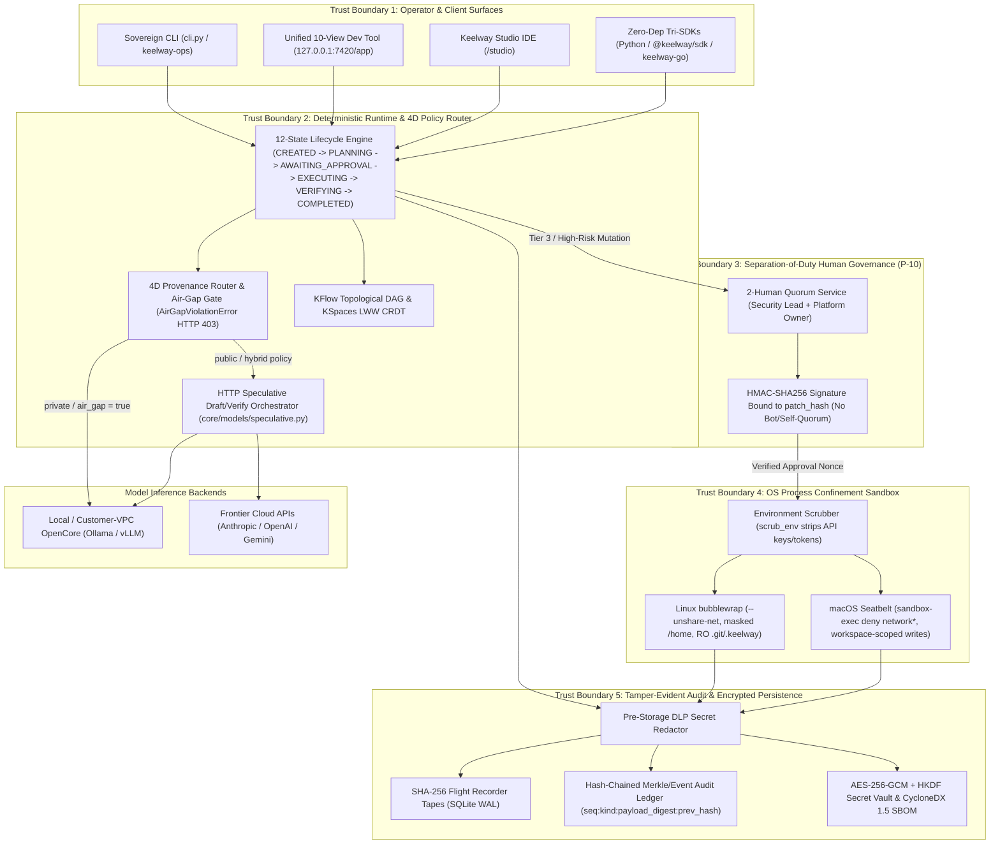

<div align="center">

# Keelway v1.1.0 by Sorvex Labs

**Sovereign Local-First Hybrid AI Engineering, Governance & Multi-Agent Runtime**

[](./CHANGELOG.md)
[](https://www.python.org/)
[](./LICENSE)
[](https://github.com/creova-gif/keelway/actions/workflows/ci.yml)

</div>

Keelway `v1.1.0` unifies local open-weight model serving (**OpenCore** via Ollama/vLLM), 4D provenance-routed frontier APIs, an explicit deterministic task state machine, separation-of-duty human-approval governance (**P-10 Gate** & 2-human quorum), OS-confined tool sandboxes (**Linux `bubblewrap`** & **macOS Seatbelt**), Model Context Protocol (**MCP `2025-06-18`**), **KFlow** topological DAG automation, **KSpaces** CRDT state sync, SHA-256 flight recorder tapes, and tri-language zero-dependency SDKs in a single customer-managed stack.

---

## Implementation Status & Technical Scope Matrix

To maintain strict claim-to-code parity for engineering and security reviewers, every capability is categorized by its verified runtime mechanism:

| Subsystem | Status | Verified Implementation & Exact Scope |
|---|---|---|
| **Deterministic Lifecycle Engine** | **Implemented & Verified** | Explicit state transition graph (`core/orchestration/state.py`, `keelway_core/engine.py`, `keelway/core/models.py`) covering canonical 12-state agent execution (`CREATED` → `CONTEXT_LOADING` → `PLANNING` → `PLAN_READY` → `AWAITING_APPROVAL` → `EXECUTING` → `VERIFYING` → `COMPLETED`, plus `PAUSED`, `BLOCKED`, `FAILED`, `CANCELLED`) |
| **OS Command Sandbox** | **Implemented & Verified** | Linux `bubblewrap` (`--unshare-net`, masked `/home`/`/root`, read-only `.git`/`.keelway`) & macOS `sandbox-exec` Seatbelt (`(deny network*)`), scrubbed child env (`core/security/env_scrub.py`), and live escape self-test (`Sandbox.verify()` in `core/agents/sandbox.py`) |
| **P-10 Gate & 2-Human Quorum** | **Implemented & Verified** | Distinct `Security Lead` + `Platform Owner` human principal enforcement, bot/agent actor rejection, source-default signing key refusal, and HMAC-SHA256 signatures bound to `patch_hash` (`keelway/approvals/quorum.py`, `core/security/approval_rules.py`) |
| **SHA-256 Flight Tapes & Audit Chain** | **Implemented & Verified** | Pre-storage DLP secret redaction, SQLite WAL SHA-256 flight recorder tapes (`core/platform/flight_tape.py`, `core/orchestration/flight_recorder.py`), and append-only hash-chained audit events (`seq:kind:payload_digest:prev_hash` in `keelway/audit/recorder.py`) |
| **Hybrid 4D Gateway & Air-Gap Mode** | **Implemented & Verified** | Drop-in `/v1/chat/completions`, stateful `/v1/responses`, `/v1/routing/explain` (weight license, hosting, operator, data boundary), and fail-closed `AirGapViolationError` (`HTTP 403`) blocking cloud egress on `private` / `air_gap` workloads |
| **Speculative Route/Prefix Orchestration** | **Implemented (HTTP-Level)** | Application/HTTP-level draft-and-verify orchestration (`core/models/speculative.py`) pairing a draft `ChatCompletionRequest` adapter with target-model verification prompts or lexical prefix alignment and cost-ledger accounting — **not** low-level GPU token-logit / shared-KV-cache kernel speculative decoding |
| **Tri-Language Zero-Dep SDKs** | **Implemented & Verified** | Python (`core/sdk`), TypeScript (`@keelway/sdk`, zero runtime npm dependencies), and Go (`keelway-go`, pure Go 1.22+ stdlib with `-race` CI verification) |
| **Tier-2 Hardware Security HAL** | **Experimental (Simulated)** | TPM 2.0 PCR quotes, PIV smartcard checks, Dual-WORM receipts, and 2-of-3 Shamir recovery (`keelway/hal/`) are software-modeled specifications requiring physical HSM/TPM hardware certification for field deployment |

---

## Architecture & Trust Boundaries



---

## Platform Surfaces

| Surface | Default Bind | Entrypoint / Source | Launch Command |
|---|---|---|---|
| **Unified 10-View Sovereign Dev Tool** | `127.0.0.1:7420/app` | `dev-app/` → `core/dev_app_dist/` (`core.main:app`) | `keelway dev` |
| **Keelway Studio IDE** | `127.0.0.1:7420/studio` | `core/studio/` (`core.main:app`) | `keelway dev` or `keelway desktop` |
| **Governance Control Plane** | `127.0.0.1:8000/` | `keelway/api/app.py` (`keelway-ops`) | `keelway-ops serve` or `make serve` |
| **Next.js 15 Product & Docs Site** | `:3000` (dev/prod) | `web-next/` | `npm --prefix web-next run dev` |

---

## Core v1.1.0 Capabilities

- **Unified 10-View Sovereign Dev Tool (`/app`)**: Overview, Coding Workspace (AST symbol index + safe patcher), Agent Teams, PM Issues & Sprints, Product PRDs & Feedback, Diataxis Docs, KFlow Automation & KSpaces CRDT, No-Code Blueprint Studio, Security/Vault/MCP/SBOM, and Subscriptions/Golden Evals — verified against **WCAG 2.2 AA (`axe-core`)**.
- **Hybrid OpenCore + Frontier 4D Gateway**: Drop-in `/v1/chat/completions`, stateful `/v1/responses`, `/v1/routing/explain` (weight license, hosting, inference operator, data residency boundary), `/v1/opencore/*` hardware/LoRA/Modelfile control, HTTP-level speculative draft/prefix routing (`core/models/speculative.py`), and `/v1/eval/swarm` MiroFish multi-agent simulation.
- **Canonical 4-Tier Pricing & BYOM 0% Markup**: Community (`$0`), BYOM Seat (`$15/seat/mo` annual — **0% token markup** on customer API keys or local GPUs), Pro (`$29/seat/mo`), and Enterprise (contact).
- **P-10 Human Approval Gate & Supply Chain Security**: Separation-of-duty P-10 human approval gate (`core/security/approval_rules.py`, `keelway/approvals/quorum.py`), workspace RBAC (`owner`, `admin`, `developer`, `operator`, `viewer`), AES-256-GCM local secret vault, SSRF-hardened HMAC-SHA256 webhooks, OS sandboxing (macOS Seatbelt & Linux Bubblewrap), and CycloneDX 1.5 SBOM provenance (`/v1/platform/security/sbom`).
- **MCP `2025-06-18` Control Plane, KFlow DAGs & KSpaces CRDT**: Built-in + SSE/stdio MCP server registry with automatic DLP secret redaction (`/v1/platform/mcp/*`), cycle-checked topological DAG execution with per-run token budgets and P-10 pause/resume (`/v1/platform/automation/workflows/execute`), and deterministic Lamport LWW CRDT state sync (`/v1/platform/kspaces/*`).
- **16-Probe Deterministic Golden Evaluation Suite**: Zero-egress subsystem verification across `workspace_ast`, `governance_p10`, `security_redteam`, and `routing_pricing` with SHA-256 SQLite WAL receipts (`keelway eval-suite --category all`).

---

## Engineering Decisions & Security Boundaries

1. **Explicit State Machine Over Unbounded Agent Loops**: Rather than allowing opaque autonomous retry loops, agent runs traverse validated transitions (`VALID_TRANSITIONS` in `core/orchestration/state.py` and `RunStatus` in `keelway/core/models.py`). Illegal state jumps raise `InvalidStateTransitionError`, and high-risk tool actions halt in `AWAITING_APPROVAL` until a cryptographic approval decision is recorded.
2. **OS Sandbox Confinement & Live Escape Self-Testing (`bubblewrap` & Seatbelt)**: Before executing any agent command, `Sandbox.verify()` (`core/agents/sandbox.py`) creates an ephemeral probe directory and attempts seven live escapes (reading sibling host secrets, writing outside workspace, opening a TCP socket, and reading/writing `.git` or `.keelway`). If any escape succeeds or no OS backend exists, `Sandbox.require_verified()` fails closed (`SandboxUnavailable`) rather than falling back to an unconfined host shell. *Boundary disclosure:* OS process sandboxes share the host kernel and are not hardware microVMs; untrusted multi-tenant SaaS workloads require outer VM/gVisor isolation.
3. **Two-Person Human Quorum & Patch-Hash Binding**: Production approvals in `TwoHumanQuorumService` (`keelway/approvals/quorum.py`) require two distinct human principals holding `Security Lead` and `Platform Owner` roles, reject actor IDs matching automated substrings (`agent`, `bot`, `ci`, `service_account`), refuse source-default signing secrets (`InsecureDefaultConfiguration`), and invalidate the quorum (`ERR_PATCH_HASH_MUTATED_QUORUM_INVALIDATED`) if a single byte of the diff changes after review.
4. **Tamper-Evident Flight Tapes vs. Keyed Non-Repudiation**: Flight recorder tapes and `AuditRecorder` chains (`seq:kind:payload_digest:prev_hash`) use canonical JSON + SHA-256 chaining in SQLite WAL. As documented in [`SECURITY.md`](./SECURITY.md), unkeyed SHA-256 chains are *tamper-evident* against accidental corruption or partial edits, whereas an attacker with raw disk write access could recompute unkeyed hashes; evidentiary non-repudiation relies on HMAC-signed receipts (`KEELWAY_POLICY_SIGNING_KEY`) and Ed25519 manifest signatures.
5. **HTTP-Level Speculative Orchestration Trade-Offs**: `SpeculativeDecodingEngine` (`core/models/speculative.py`) operates across provider HTTP adapters (draft completion + target verification prompt or prefix check) rather than sharing GPU KV-caches inside a C++/CUDA inference kernel. It reduces frontier output-token spend when a fast local OpenCore model drafts accepted completions, whereas serial remote-API round-trips can increase wall-clock latency if draft acceptance is low.
6. **Fail-Closed Secrets, Container Isolation & Private PII Intake**: Child tool environments are scrubbed via `core/security/env_scrub.py` (tested against every secret variable in [`.env.example`](./.env.example)); the production [`Dockerfile`](./Dockerfile) runs multi-stage `python:3.14-slim` as non-root UID `10001:10001`; and [`api/early-access.js`](./api/early-access.js) enforces strict `Origin` allowlists, `4 KB` payload bounds, per-IP rate limiting, and private HTTPS webhook delivery (`EARLY_ACCESS_WEBHOOK_URL`), failing closed (`503`) rather than ever posting user emails to public GitHub Issues.

---

## Installation & Configuration

### 1. Source Checkout or Python Wheel (`pip` / `uv`)

```bash
git clone https://github.com/creova-gif/keelway.git
cd keelway
cp .env.example .env   # Optional: configure model keys or local Ollama URL; never commit .env
python3 -m venv .venv
source .venv/bin/activate
pip install -e ".[dev]"

# Build & install standalone wheel (bundles /app and /studio SPA assets)
python -m build --wheel --outdir dist/
```

Installed console scripts:
- `keelway` → `cli:main` (Unified Dev Tool, Studio, MCP, Golden Eval Suite, Vault, Workspace, TUI)
- `keelway-ops` → `keelway.cli.main:main` (Governance Control Plane `:8000`, Runner Daemon, Audit Verification)
- `keelway-core` → deprecated alias for `keelway-ops` (emits a warning; will be removed in a future release)

### 2. POSIX Installer & Homebrew Formula

```bash
# Inspect zero-write installation plan first
./scripts/install.sh --dry-run --json
sh web-next/public/install.sh --dry-run

# Homebrew formula (macOS / Linuxbrew)
ruby -c Formula/keelway.rb
```

### 3. Non-Root Docker & Docker Compose

[`Dockerfile`](./Dockerfile) builds a multi-stage `python:3.14-slim` image running as unprivileged UID `10001:10001` with aligned `/usr/local/lib/python3.14/site-packages` artifacts and a persistent `/data` volume (`KEELWAY_STATE_DIR=/data/.keelway`, `KEELWAY_DB_PATH=/data/keelway_audit.db`), exposing both `:8000` (Governance Control Plane) and `:7420` (Unified Platform API & `/app`).

```bash
export KEELWAY_POLICY_SIGNING_KEY="$(python3 -c 'import secrets; print(secrets.token_hex(32))')"
docker compose up -d
```

---

## Official Tri-Language SDKs (100% Parity)

All three SDKs expose full parity across Inference, 4D Routing, OpenCore, Governance, GPU Cluster Scheduling, MCP Control Plane, Golden Evals, KFlow DAG Execution, KSpaces CRDT Sync, and CycloneDX SBOM verification:

1. **Python (`core.sdk`)** — Sync `KeelwayClient` & Async `AsyncKeelwayClient`:
   ```python
   from core.sdk import KeelwayClient

   with KeelwayClient(base_url="http://127.0.0.1:7420", token="kw_live_...") as client:
       run = client.platform.execute_kflow_dag("WF-01", nodes=[{"id": "lint", "kind": "agent"}])
       sbom = client.platform.get_platform_sbom()
   ```
2. **TypeScript (`@keelway/sdk` in `sdk/typescript/`)** — Zero runtime dependencies, Node 20+ / Bun / Deno / Workers:
   ```ts
   import { KeelwayClient } from "@keelway/sdk";

   const client = new KeelwayClient({ baseUrl: "http://127.0.0.1:7420", apiKey: "kw_live_..." });
   const state = await client.platform.getKspacesState({ workspace_id: "default" });
   ```
3. **Go (`github.com/keelway/keelway-go` in `sdk/go/`)** — Pure Go 1.22+ standard library:
   ```go
   client := keelway.NewClient("http://127.0.0.1:7420", keelway.WithAPIKey("kw_live_..."))
   sbom, err := client.Platform.GetPlatformSbom(ctx, "default")
   ```

---

## Engineering Verification & Release Gates

```bash
# 1. Universal 8-stage engineering quality gate (Python, Tri-SDKs, Website drift, Sandbox, E2E)
./scripts/verify_engineering_gates.sh

# 2. Deterministic 16-probe Golden Evaluation Suite
keelway eval-suite --category all --json

# 3. Official TypeScript & Go SDK suites + Unified Dev Tool WCAG 2.2 AA suite
./sdk/typescript/node_modules/.bin/tsc -p sdk/typescript/tsconfig.json && npm --prefix sdk/typescript test
(cd sdk/go && go vet ./... && go test ./... -race)
npm --prefix dev-app test

# 4. Fail-closed macOS Seatbelt + live Ollama release gate (.github/workflows/release-gate-macos.yml)
python -m tests.release_live_gate
```

---

## Repository Layout

```text
├── cli.py                    # Sovereign developer CLI (`keelway`)
├── core/                     # Unified Platform API (:7420), OpenCore, MCP, KFlow, KSpaces, Vault, SDK
├── keelway/                  # Governance Control Plane (:8000), Policy Engine, Quorum, Audit Ledger
├── dev-app/                  # React 19 + TypeScript Unified 10-View Sovereign Dev Tool -> core/dev_app_dist/
├── web-next/                 # Next.js 15 App Router marketing, product, docs & early-access intake
├── api/early-access.js       # Fail-closed early-access intake reference (canonical port: web-next/src/app/api/early-access)
├── sdk/
│   ├── typescript/           # @keelway/sdk v1.1.0 (zero runtime dependencies)
│   └── go/                   # keelway-go (pure Go stdlib)
├── Formula/keelway.rb        # Homebrew formula
├── .env.example              # Documented runtime & webhook environment placeholders (zero secrets)
├── .github/CODEOWNERS        # Review ownership routing (@creova-gif)
└── tests/                    # Comprehensive unit, adversarial safety, E2E, and live release gates
```

---

## Security, Contributing & License

- **Security Policy & Threat Model**: See [`SECURITY.md`](./SECURITY.md) for private vulnerability reporting and cryptographic audit-tape scope notes.
- **Contributing & Agent Governance**: See [`CONTRIBUTING.md`](./CONTRIBUTING.md), [`CODE_OF_CONDUCT.md`](./CODE_OF_CONDUCT.md), and [`AGENTS.md`](./AGENTS.md).
- **License**: Licensed under the [Apache License 2.0](./LICENSE).
