# Keelway v1 — Hybrid AI Platform Architecture & Reference

## 1. Platform Overview

**Keelway** (`creova-gif/kora`) is a model-agnostic Hybrid AI Platform engineered to treat **Open-Weight models** (including the sovereign **Keelway OpenCore** suite, Qwen, Llama, Mistral, DeepSeek, and Gemma) and **Closed/Proprietary commercial models** (Google Gemini, OpenAI, Anthropic) as equal, first-class citizens behind a single governed control plane.

Every inference request passes through deterministic security, privacy, residency, and cost controls before reaching any local or remote runtime.

```mermaid
flowchart TD
    subgraph L1["Layer 1 — Experience & Developer Interfaces"]
        WC["Web Console (/console — 6-Tab Air-Gap UI)"]
        SDK["Python SDK v1 (AsyncKeelwayClient & KeelwayClient)"]
        CLI["Developer CLI (keelway opencore | route | swarm | governance)"]
    end

    subgraph L2["Layer 2 — Unified AI & Evaluation API"]
        CC["POST /v1/chat/completions"]
        RSP["POST /v1/responses & GET /v1/responses/{id}"]
        MOD["GET /v1/models & GET /v1/usage"]
        EXP["POST /v1/routing/explain & GET /v1/routing/decisions"]
        EVL["POST /v1/eval/swarm & POST /v1/eval/benchmark"]
    end

    subgraph L6["Layer 6 — Multi-Tenant Governance & Security"]
        GOV["Scoped API Keys (kw_live_*) + Token-Bucket Rate Limiter"]
        SPD["Tenant Spend Caps (402 Block or Auto-Downgrade to OpenCore)"]
        FW["SecurityGateway (Prompt-Injection Block + Secret Redaction) + AirGapEnforcer"]
        AUD["Hash-Chained Governance Audit Log (Zero Raw Prompt Storage)"]
    end

    subgraph L5["Layer 5 — Deterministic Hybrid Router & Speculative Engine"]
        RTR["ModelGateway.explain_route() + 4-Dimension Provenance"]
        SPEC["SpeculativeDecodingEngine (OpenCore Draft -> Frontier Verifier)"]
    end

    subgraph L4["Layer 4 — Centralized Model Registry & OpenCore Catalog"]
        REG["ModelRegistry (Capabilities, Licenses, Pricing, Context Limits)"]
        WGT["OpenCore WeightManager (SHA-256 GGUF/AWQ + HardwareProfiler)"]
        ADP["LoRAAdapterRegistry + Multilingual QLoRA Recipes (Swahili/Yoruba/Hausa/Amharic)"]
    end

    subgraph L3["Layer 3 — Normalized Provider & Runtime Abstraction"]
        OC["OpenCoreServingEngine (OllamaRuntimeBridge / VLLMRuntimeBridge / In-Process)"]
        GEM["GeminiProviderAdapter (v1beta REST + SSE + JSON Mode)"]
        OAI["OpenAIProviderAdapter (v1 Chat + SSE)"]
        ANT["AnthropicProviderAdapter (Messages API + SSE)"]
    end

    L1 --> L2
    L2 --> L6
    L6 --> L5
    L5 --> L4
    L4 --> L3
```



---

## 2. Six-Layer Capability Matrix (Verified vs. Roadmap)

| Layer | Subsystem | Primary Implementation Files | Verification Status |
|---|---|---|---|
| **Layer 1: Experience & Interfaces** | 6-Tab Hybrid AI Web Console (`/console`), Keelway Studio (`:7420`) with Agent Manifest Inspection Panel (`/v1/studio/manifests`), Next.js 15 Flagship Website (`website/`), Python SDK v1 (`core/sdk`), Official TypeScript SDK v1 (`sdk/typescript` — `@keelway/sdk`), Developer CLI (`opencore`, `route`, `swarm`, `governance`) | `web-console/index.html`, `core/studio/index.html`, `core/api/studio.py`, `core/sdk/client.py`, `sdk/typescript/src/client.ts`, `core/cli_ai.py`, `website/src/` | **Verified** (`tests/test_sdk_v1.py`, `sdk/typescript/test/sdk.test.mjs`, `tests/test_cli_ai.py`, `tests/test_studio_manifest_panel.py`, `tests/test_website_facts.py`) |
| **Layer 2: Unified AI API** | `GET /v1/models`, `POST /v1/chat/completions` (JSON + SSE + OpenAI `response_format` / `max_completion_tokens`), `POST /v1/responses` (stateful `previous_response_id` + SSE + speculative option), `GET /v1/usage`, `POST /v1/eval/swarm`, `POST /v1/eval/benchmark` (186 total OpenAPI 3.1 endpoints) | `core/api/routes.py`, `core/api/responses_routes.py`, `core/api/opencore_routes.py` | **Verified** (`tests/test_hybrid_routing_and_api.py`, `tests/test_responses_and_routing_api.py`, `tests/test_mirofish_integration.py`, `tests/test_api_export.py`) |
| **Layer 3: Provider & Runtime Abstraction** | `BaseModelProvider` contract across `OpenWeightProviderAdapter`, `OpenCoreServingEngine` (`OllamaRuntimeBridge` + `VLLMRuntimeBridge`), `GeminiProviderAdapter`, `OpenAIProviderAdapter`, `AnthropicProviderAdapter` | `core/models/provider.py`, `core/models/adapters/*.py`, `core/opencore/runtime.py`, `core/opencore/serving.py` | **Verified** (`tests/test_hybrid_adapters.py`, `tests/test_gemini_adapter.py`, `tests/test_anthropic_adapter.py`, `tests/test_opencore_runtime.py`, plus live `qwen3.5:latest` & live `gemini-3.5-flash-lite`) |
| **Layer 4: Model Registry & OpenCore** | Centralized `ModelRegistry` (capabilities, verified context windows, pricing, licenses), `WeightManager` (SHA-256 verification), `OpenCoreModelfileCompiler`, `LoRAAdapterRegistry` hot-swap, African-language QLoRA distillation (`DomainDatasetBuilder`) | `core/models/registry.py`, `core/opencore/weights.py`, `core/opencore/adaptation.py`, `core/opencore/runtime.py` | **Verified** (`tests/test_hybrid_model_registry.py`, `tests/test_opencore.py`, `tests/test_opencore_runtime.py`) |
| **Layer 5: Hybrid Routing & Speculative Decoding** | Deterministic local-first cost arbitrage, fail-closed privacy (`privacy_level="private"`), 4-dimension routing provenance (`POST /v1/routing/explain`), `SpeculativeDecodingEngine` (`keelway-nano:1.5b` draft -> frontier verifier) | `core/models/gateway.py`, `core/models/speculative.py`, `core/api/responses_routes.py` | **Verified** (`tests/test_speculative_decoding.py`, `tests/test_responses_and_routing_api.py`) |
| **Layer 6: Multi-Tenant Governance & OS Sandbox** | `TenantPolicy` (`DataResidencyZone`), salted SHA-256 `ScopedAPIKeyManager` (`kw_live_*`), `TokenBucketRateLimiter`, `TenantSpendMeter` (`402` or OpenCore auto-downgrade), `HashChainedGovernanceAuditLog`, crash-safe `SQLiteGovernanceStore` (WAL mode), `Sandbox` (`SeatbeltBackend` + hardened `BubblewrapBackend`), `SecurityGateway`, `AirGapEnforcer` | `core/security/tenant_governance.py`, `core/security/governance_store.py`, `core/api/governance_routes.py`, `core/agents/sandbox.py`, `core/security/firewall.py`, `core/security/airgap.py`, `core/security/redact.py` | **Verified** (`tests/test_tenant_governance.py`, `tests/test_persistent_governance.py`, `tests/test_agent_sandbox.py`, `tests/test_redact.py`) |

---

## 3. Four-Dimension Routing Provenance Model

Keelway never conflates **open-weight licensing** with **private data processing**. Every routing decision records four independent dimensions:

1. **Model Weight Ownership & License:** e.g., `Apache-2.0` (`keelway-core:7b`, `qwen2.5-coder:7b`) vs. `Proprietary Commercial Terms` (`gemini-3.5-flash-lite`, `gpt-4o`, `claude-sonnet-4-20250514`).
2. **Hosting Location:** Local workstation / on-prem cluster vs. self-hosted VPC GPU vs. multi-tenant vendor cloud region.
3. **Service Operator:** Customer self-operated (`Ollama` / `vLLM`) vs. third-party inference operator.
4. **Data Processing Boundary:** `zero_external_egress` (enforced for `privacy_level="private"` and `AirGapEnforcer(enabled=True)`) vs. `external_commercial_inference_endpoint`.

When `privacy_level="private"` is set and a caller explicitly requests a closed cloud model, Keelway **fails closed** rather than silently routing private data to an external vendor.

---

## 4. Legitimate Open-Weight Acquisition & Local Serving Quickstart

Model weights and binary checkpoints are **never committed to Git**. Developers acquire permitted weights from upstream sources or verified artifact registries:

```bash
# 1. Pull an Apache-2.0 open-weight model into your local Ollama runtime
ollama pull qwen3.5:latest

# 2. Inspect host hardware profile, VRAM budget, and discovered local runtimes
cd keelway
python cli.py opencore status --json

# 3. Compile a deterministic Ollama Modelfile for Keelway OpenCore
python cli.py opencore modelfile --model keelway-core:7b --quantization q4_k_m --out ./Modelfile

# 4. Explain a routing policy before sending traffic
python cli.py route explain --prompt "Analyze confidential ledger" --privacy private --json

# 5. Run the 5-stage MiroFish × Keelway hybrid multi-agent swarm benchmark
python cli.py swarm run --rounds 1 --json
```

---

## 5. Honest Distinction: Functioning v1 Capabilities vs. Future Roadmap

### Functioning & Verified Today
- Unified REST + SSE API (`/v1/models`, `/v1/chat/completions`, `/v1/responses`, `/v1/usage`, `/v1/opencore/*`, `/v1/routing/*`, `/v1/governance/*`, `/v1/eval/*`, `/v1/studio/manifests*` — 186 OpenAPI 3.1 operations).
- Real neural inference across local Ollama (`qwen3.5:latest` on Apple Silicon Metal) and live Google Gemini (`gemini-3.5-flash-lite` / `gemini-3.5-flash`), plus contract-tested OpenAI and Anthropic adapters.
- Cryptographic SHA-256 weight manifest verification, Ollama `Modelfile` compilation, hot-swappable LoRA adapter registry, and executable Unsloth/PEFT QLoRA recipes with African-language seed corpora.
- Multi-tenant governance with salted SHA-256 scoped API keys, token-bucket rate limiting, USD spend caps with OpenCore fallback, prompt-injection blocking, secret redaction, and crash-safe SQLite WAL persistence (`SQLiteGovernanceStore`) preserving tamper-evident SHA-256 hash-chained audit logs across restarts (`KEELWAY_GOVERNANCE_DB_PATH`).
- Hardened OS command sandboxing across macOS Seatbelt and Linux Bubblewrap (`Sandbox.diagnose()`, AppArmor/userns diagnostics, and fail-closed Linux CI escape-probe enforcement) plus Web Developer Studio Agent Manifest Inspection & HMAC-SHA256 verification.
- Official Python SDK v1 (`core/sdk`) and zero-dependency TypeScript/JS SDK v1 (`sdk/typescript` — `@keelway/sdk`), plus the Next.js 15 Flagship Website (`website/`) with `Cmd+K` search, 60fps runtime captures, empirical TTFT/Cost scatter plots, and a rate-limited live routing sandbox.
- End-to-end compatibility with external multi-agent frameworks (`MiroFish` `OntologyGenerator` + `OasisProfileGenerator` via official `openai` Python SDK).

### Future Roadmap (Not Claimed as Shipped)
- **Distributed Multi-Node GPU Scheduling:** Extending `OpenCoreServingEngine` from single-host `Ollama`/`vLLM` bridges to Kubernetes Ray/vLLM multi-node tensor-parallel scheduling.
- **Cluster-Wide Multi-Node Redis/PostgreSQL Governance Store:** Extending single-node crash-safe `SQLiteGovernanceStore` WAL persistence to multi-region PostgreSQL/Redis distributed row locking for horizontally sharded API gateways.
- **Custom Pre-Trained Foundation Checkpoints:** Current `keelway-*` OpenCore profiles bind onto verified Apache-2.0 foundation backbones (`Qwen` / `Mistral` / `Llama`) plus domain QLoRA adapters rather than from-scratch pre-training runs.
- **Go & Rust SDK Packages + Ed25519 Public-Key Manifest Signing:** Adding Go/Rust client packages alongside Python (`core/sdk`) & TypeScript (`@keelway/sdk`), and upgrading `AgentManifest` workspace HMAC-SHA256 signing to asymmetric Ed25519 registry keys.
