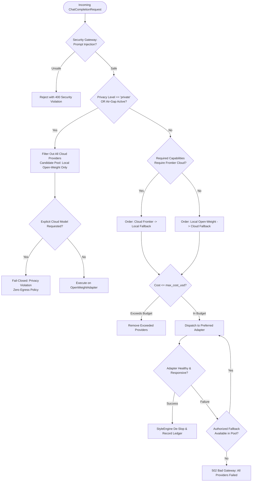

# Keelway Model Routing & Orchestration Design

## 1. Routing Objectives and Deterministic Principles

The Keelway Model Router (`core/models/gateway.py`) implements a deterministic policy algorithm prioritizing **sovereignty, privacy, and cost arbitrage**:

1. **Deterministic Selection Over Black-Box Learning:** Routing policies are fully rule-based, predictable, and explainable. No stochastic black-box router is employed.
2. **Local-First Cost Arbitrage:** Unless the request demands specialized frontier capabilities (such as multimodal vision or extended 128k context), the router directs traffic to open-weight local instances at $0.00 marginal cost.
3. **Hard Privacy Invariant (Fail-Closed):** If `privacy_level == "private"`, all cloud providers are strictly excluded. If a user explicitly specifies a closed cloud model under private mode, the router rejects the request immediately rather than silently breaching privacy.
4. **Explainable Decision Audit Trails:** Every inference response attaches a `routing_reason` breadcrumb recording exactly why the selected model was chosen and whether any fallback occurred.

---

## 2. Policy Routing Algorithm Flowchart

---

## 3. Fallback and Containment Matrix

| Request Scenario | Primary Route | Fallback Policy | Governance Rule |
|---|---|---|---|
| `privacy_level = "private"` | Open-weight local model (`qwen2.5-coder:7b`) | Permitted secondary local model only | **Zero Cloud Egress:** Cloud providers are never contacted under any circumstance. |
| `privacy_level = "standard"`, Code Task | Open-weight local model | Cloud (`gpt-4o-mini` or `gpt-4o`) if local is down | Escalates only if budget cap permits; logs fallback reason in cost ledger. |
| `required_capabilities = ["vision"]` | Closed cloud provider (`gpt-4o`) | Secondary cloud provider | Local model lacks vision weights; explicit escalation required. |
| Air-gap flag engaged (`air_gap.enabled = True`) | Local open-weight runtime | None | Disables outbound socket connectivity for all inference calls. |
