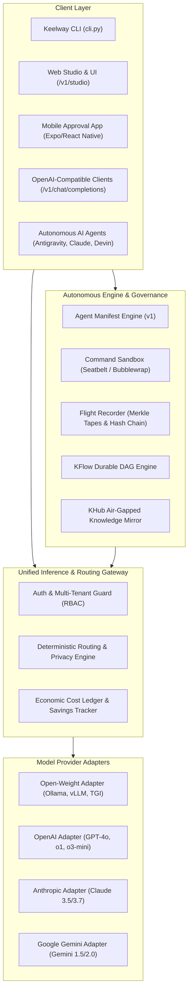

# Keelway — End-to-End System Overview

> **Version**: 1.0 (Production Core & Multi-Agent Architecture)  
> **Status**: Active Architecture  
> **Author**: Keelway AI Infrastructure Architecture Group

---

## 1. Executive Architecture Summary

Keelway is an autonomous, sovereign enterprise AI development and execution platform. It enables organizations to run private, secure, and cost-controlled AI agents, models, and workflows across hybrid compute environments (on-device, self-hosted GPU clusters, and frontier cloud APIs).

---

## 2. Core Subsystems

### 2.1 Unified AI Model Gateway (`core/models/`)
- **Model Registry (`core/models/registry.py`)**: Central repository of all supported models across open-weight (Qwen, Llama, DeepSeek, Mistral) and closed proprietary tiers (OpenAI, Anthropic, Google).
- **Provider Adapters (`core/models/adapters/`)**: Normalized HTTP client adapters translating universal `ChatCompletionRequest` into provider-specific payloads, handling SSE streaming chunks and unifying error structures.
- **Model Gateway (`core/models/gateway.py`)**: Enforces routing policies, privacy fail-closed boundaries (blocking cloud egress for private requests), automatic fallback routing, and cost accounting.
- **Cost Ledger (`core/models/cost_ledger.py`)**: Computes real-time token economics, tracking external cloud spend vs. quantified savings from open-weight local execution.

### 2.2 Autonomous Orchestration & Agent Loops (`core/orchestration/`)
- **Agent Loop (`core/orchestration/agent_loop.py`)**: Multi-turn autonomous tool execution loop with iterative observation-action cycles.
- **Flight Recorder (`core/orchestration/flight_recorder.py`)**: Cryptographically sealed session tapes with automated secret redaction, SHA-256 integrity checksums, and execution replay.
- **Command Sandbox (`core/agents/sandbox.py`)**: OS-level boundary enforcement (macOS Seatbelt, Linux bubblewrap) restricting filesystem, process, and socket operations for agent tool execution.

### 2.3 Durable DAG & Execution Engine (`core/kflow/`, `core/khub/`, `core/kspaces/`)
- **KFlow**: Durable, stateful task Directed Acyclic Graph (DAG) orchestration engine supporting pause/resume, human approval gates, and node retries.
- **KHub**: Secure, air-gapped skill, prompt, and model template repository supporting cryptographic package signing and offline mirrors.
- **KSpaces**: Isolated workspace state manager providing transactional file manipulation, rollbacks, and multi-agent coordination.

### 2.4 Governance, Security & Telephony (`core/security/`, `core/api/`)
- **Governance Gate**: Three-tier autonomy policy (`Tier 1 Safe`, `Tier 2 Governed`, `Tier 3 High Risk`).
- **Approval Relays**: Remote approval dispatch via Telegram, WhatsApp, and WebSockets allowing human-in-the-loop sign-off on destructive actions.
- **Merkle Audit Trail**: Hash-chained event log ensuring non-repudiation of all agent operations.

---

## 3. Data & Request Lifecycle

1. **Ingress**: Request received via CLI, Web Studio, or REST API (`/v1/chat/completions`, `/v1/agent/run`).
2. **Authentication & Governance Check**: Principal identity verified, tenant permissions checked, and autonomy level resolved against agent manifest.
3. **Privacy Inspection**: Request inspected for `is_private` or `air_gap` flags. If sensitive, router constrains candidate models strictly to `open_weight` deployed locally or in private VPC.
4. **Execution & Flight Recording**:
   - For agent runs: Sandboxed commands execute, credentials are automatically redacted, and events are chained into the Merkle flight tape.
   - For inference: Request is dispatched to the chosen adapter, tokens stream back via SSE, and token usage is registered with the Cost Ledger.
5. **Egress**: Sealed response and cryptographic execution receipt returned to the client.
