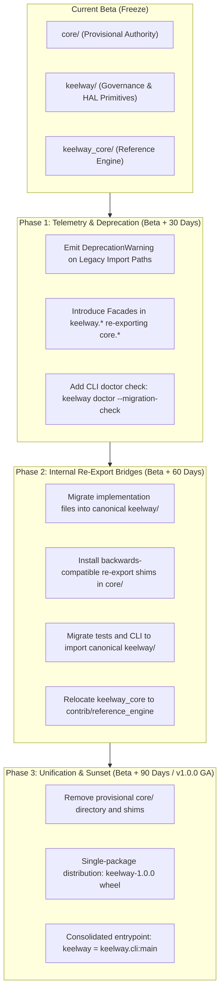

# ADR-0042: Consolidate Runtime Packages Post-Beta with Provisional Core Authority

- **Status:** Accepted (Governance Mandate)
- **Date:** 2026-11-08
- **Author:** Principal Software Architect
- **Governing Directives:** Section 4 of Master Directive, Dual-Mode PRD, Keelway Architecture & Decision Precedence Register ([decision-precedence.md](decision-precedence.md))
- **Supersedes:** None (Formalizes runtime authority across prototype lineages)
- **Target Implementation:** Beta Release (Provisional Authority) $\longrightarrow$ Post-Beta Convergence (Phases 1–3)

---

## 1. Context and Problem Statement

A comprehensive codebase audit of the Keelway repository reveals three parallel runtime packages resulting from concurrent development streams:

1. **`core/` (~23,531 LOC):** The primary live production runtime. It powers the Autonomous ReAct Agent Loop (`AutonomousAgentLoop`), Studio SPA and Proof Strip, multi-agent mesh, AST semantic index, 16-state deterministic finite state machine (`TaskState`), air-gapped zero-egress enforcement, OS-level confinement sandboxing (Seatbelt / Bubblewrap), and the interactive developer CLI.
2. **`keelway/` (~4,737 LOC):** The enterprise governance suite created for enterprise pilot compliance. It provides two-human quorum signing (`TwoHumanQuorumService`), fail-closed source default verification (`InsecureDefaultConfiguration`), a persistent SQLite WAL audit store (`keelway_audit.db`), git worktree management, Model Context Protocol (MCP) governance bridges, and Tier-2 Hardware Abstraction Layer (HAL) verifiers.
3. **`keelway_core/` (~318 LOC):** A minimalist, standalone, un-sandboxed reference workflow engine (`keelway-ref`). It was created as an educational and testing baseline with zero external dependencies, explicitly marked as non-enterprise qualified.

### The Immediate Challenge

With the upcoming Beta milestone, executing an aggressive structural rewrite or package unification carries unacceptable release risks:
- Over 376 test assertions and production entrypoints directly import `core.*`.
- Critical enterprise security checks in `core/` selectively import trusted primitives from `keelway.*` (e.g., `keelway.security.source_defaults`, `keelway.approvals.quorum`, `keelway.runner.enrollment`).
- A premature consolidation would risk circular dependency cycles, runtime state machine regressions, and test suite instability.

Per **Section 4 of the Master Directive**:
> *"Develop a post-beta consolidation ADR rather than conducting a risky rewrite before release. Treat core/ as the provisional runtime authority, map all overlapping functionality, document which implementation is authoritative, and keep alternative packages stable."*

This ADR establishes `core/` as the provisional runtime authority for Beta, defines an authoritative mapping across all overlapping subsystems, establishes strict pre-beta compatibility rules, and charts a structured three-phase post-beta convergence roadmap to a unified `keelway` namespace.

---

## 2. Invariants and Architectural Precedence

All decisions in this ADR comply with the governing invariants specified in [decision-precedence.md](decision-precedence.md):

1. **Sovereign Local-First & Zero-Egress Invariant:** Default execution mode is strictly `LOCAL_ONLY`. Silent fallback to cloud LLMs is categorically prohibited. Outbound network telemetry during execution is blocked at the process boundary.
2. **Deterministic 16-Member State Machine:** The authoritative task state model is `TaskState` in [`core/orchestration/state.py`](../../core/orchestration/state.py) with its strict `VALID_TRANSITIONS` table. Any legacy 8-state or 11-state models are subordinate to this machine.
3. **Shared Runtime Invariant (Dual-Mode Parity):** IDE Mode and Agent Builder Mode execute through the identical runtime engine (`AutonomousAgentLoop` wrapped by `ManifestGuard`). No secondary builder runtime is permitted.
4. **The Proof Strip Sequence:** Every UI execution flow must verifiably reflect:
   $$\text{INSPECT} \longrightarrow \text{PLAN} \longrightarrow \text{AUTHORIZE} \longrightarrow \text{EXECUTE} \longrightarrow \text{VERIFY} \longrightarrow \text{SEAL}$$
5. **Tier-2 HAL Qualification:** All Tier-2 HAL capabilities (TPM 2.0 quotes, PIV smartcards, Dual-WORM receipts) in `keelway/hal` remain classified as **EXPERIMENTAL / SOFTWARE-SIMULATED** until physically qualified on target hardware.

---

## 3. Decision

1. **Designate `core/` as Provisional Runtime Authority:** For the Beta release, `core/` is the authoritative live runtime product. All agent loops, task state management, Studio API routes, and developer CLI tools run through `core/`.
2. **Retain `keelway/` for Enterprise Governance & Security Primitives:** `keelway/` remains active and stable without modification prior to Beta. Specific security modules (`source_defaults.py`, `quorum.py`, `hal/`, `runner/enrollment.py`) continue to be consumed directly by `core/`.
3. **Isolate `keelway_core/` as a Reference Implementation:** `keelway_core/` is maintained as a zero-dependency reference workflow engine. It must never import from `core` or `keelway`, and its CLI (`keelway-ref`) continues to require `--ack-unsandboxed` for execution.
4. **Preserve Zero Breaking Changes:** No module paths, public symbols, database schemas, or CLI scripts will be renamed or deleted prior to Beta GA.
5. **Execute a Three-Phase Post-Beta Consolidation:** Converge the entire codebase into a clean, single-package architecture under `keelway/` post-beta following the phased schedule defined in Section 6.

---

## 4. Authoritative Subsystem Mapping Table

The following matrix establishes runtime authority across all subsystems for the Beta release:

| Subsystem | `core/` Implementation | `keelway/` Implementation | `keelway_core/` Implementation | Authoritative Owner (Beta) | Pre-Beta Compatibility & Interop Rule |
| :--- | :--- | :--- | :--- | :--- | :--- |
| **Sandbox & Confinement** | [`core/agents/sandbox.py`](../../core/agents/sandbox.py)<br>[`core/orchestration/worktree.py`](../../core/orchestration/worktree.py)<br>[`core/storage/workspace_fs.py`](../../core/storage/workspace_fs.py) | [`keelway/sandbox/workspace.py`](../../keelway/sandbox/workspace.py) | [`keelway_core/engine.py`](../../keelway_core/engine.py)<br>(`safe_target` guard) | **`core/agents/sandbox.py`** | `Sandbox.require_verified()` is the mandatory OS isolation boundary (macOS Seatbelt / Linux Bubblewrap). `keelway/sandbox` used solely by CI runner. `keelway_core` requires `--ack-unsandboxed`. |
| **Approvals & Quorum** | [`core/security/approval_rules.py`](../../core/security/approval_rules.py)<br>[`core/api/approval_relay.py`](../../core/api/approval_relay.py)<br>[`core/orchestration/state.py`](../../core/orchestration/state.py) | [`keelway/approvals/service.py`](../../keelway/approvals/service.py)<br>[`keelway/approvals/quorum.py`](../../keelway/approvals/quorum.py) | [`keelway_core/engine.py`](../../keelway_core/engine.py)<br>(`approve` CLI command) | **`core/` Runtime State**<br>+ **`keelway/approvals/quorum.py`** for Enterprise Quorum | `core/orchestration/state.py` owns `TaskState.AWAITING_APPROVAL`. Standing approvals handled in `core/security/approval_rules.py`. `core/api/routes.py` dynamically invokes `TwoHumanQuorumService` when production quorum is mandated. |
| **Policy Engine & Guardrails** | [`core/security/airgap.py`](../../core/security/airgap.py)<br>[`core/security/firewall.py`](../../core/security/firewall.py)<br>[`core/security/rbac.py`](../../core/security/rbac.py)<br>[`core/agents/guard.py`](../../core/agents/guard.py) | [`keelway/policy/engine.py`](../../keelway/policy/engine.py)<br>[`keelway/policy/bundle.py`](../../keelway/policy/bundle.py)<br>[`keelway/security/source_defaults.py`](../../keelway/security/source_defaults.py) | *None* (CLI argument validation only) | **`core/security/`**<br>+ **`keelway/security/source_defaults.py`** | `AirGapEnforcer` and `DLPScanner` govern live interactive sessions. `source_defaults.py` strictly prevents source-default credential startup across both `core` and `keelway`. |
| **Audit, Ledger & Flight Tape** | [`core/orchestration/flight_recorder.py`](../../core/orchestration/flight_recorder.py)<br>[`core/security/merkle_audit.py`](../../core/security/merkle_audit.py)<br>[`core/storage/ledger.py`](../../core/storage/ledger.py) | [`keelway/audit/recorder.py`](../../keelway/audit/recorder.py)<br>[`keelway/audit/store.py`](../../keelway/audit/store.py)<br>[`keelway/audit/export.py`](../../keelway/audit/export.py) | [`keelway_core/engine.py`](../../keelway_core/engine.py)<br>(`audit` event list) | **`core/orchestration/flight_recorder.py`**<br>(Interactive Sessions)<br>**`keelway/audit/store.py`**<br>(Compliance WAL) | `FlightRecorder` writes byte-for-byte `.keelway/recordings/` for time-travel replay. `keelway/audit/store.py` maintains persistent `keelway_audit.db` hash chains for pipeline runs. |
| **API Routes & Web Surface** | [`core/main.py`](../../core/main.py)<br>[`core/api/routes.py`](../../core/api/routes.py)<br>[`core/studio/index.html`](../../core/studio/index.html) | [`keelway/api/app.py`](../../keelway/api/app.py)<br>[`keelway/api/routes.py`](../../keelway/api/routes.py) | *None* (CLI only) | **`core/main.py`**<br>(Authoritative FastAPI Host & Studio) | `core/main.py` serves the primary Keelway Studio UI and core endpoints. `keelway/api/app.py` serves operator dashboard for headless CI/CD runner workflows. |
| **CLI Entrypoint** | [`cli.py`](../../cli.py)<br>(Registered as `keelway = "cli:main"`) | [`keelway/cli/main.py`](../../keelway/cli/main.py)<br>(Registered as `keelway-core = "keelway.cli.main:main"`) | [`keelway_core/cli.py`](../../keelway_core/cli.py)<br>(`keelway-ref`) | **`cli.py` (`keelway`)** | `keelway` CLI is the developer tool (`chat`, `doctor`, `brief`, `sandbox`). `keelway-core` CLI is preserved for operator pipeline reviews. |
| **Workflow Engine & Orchestration** | [`core/orchestration/agent_loop.py`](../../core/orchestration/agent_loop.py)<br>[`core/orchestration/state.py`](../../core/orchestration/state.py)<br>[`core/kflow/engine.py`](../../core/kflow/engine.py) | [`keelway/core/runner.py`](../../keelway/core/runner.py)<br>[`keelway/runner/daemon.py`](../../keelway/runner/daemon.py) | [`keelway_core/engine.py`](../../keelway_core/engine.py)<br>(Reference step engine) | **`core/orchestration/agent_loop.py`**<br>+ **`core/orchestration/state.py`** | `AutonomousAgentLoop` is the sole engine for agent task execution. `GovernedRunCoordinator` in `keelway` acts as a macro-orchestrator for fixed pipeline runs. |

### Domain Extensions and Specialized Subsystems

The following domain packages remain cleanly segregated and fully authoritative in their existing locations:

- **Knowledge & Memory (`core/kbrain/`):** Authoritative semantic memory and embedding store.
- **Agent Spaces & Collaboration (`core/kspaces/`):** Authoritative CRDT workspace synchronization and multi-agent conflict resolution.
- **Hub & Git Sync (`core/khub/`):** Authoritative remote Git repository synchronizer.
- **Skills & Extension Registry (`core/kstack/`):** Authoritative catalog of modular agent capabilities and tools.
- **Workflow DAG Engine (`core/kflow/`):** Directed Acyclic Graph engine for multi-step agent pipelines.
- **Hardware Abstraction Layer (`keelway/hal/`):** Tier-2 HAL modules (`tpm.py`, `piv.py`, `worm.py`, `recovery.py`). Preserved in `keelway/hal/` with status `EXPERIMENTAL / SOFTWARE-SIMULATED`.
- **MCP Governance Bridge (`keelway/mcp/`):** Model Context Protocol governance integration.
- **GitHub CI/CD Service (`keelway/git_ci/`):** GitHub pull request and status webhook automation.

---

## 5. Pre-Beta Compatibility Preservation Rules

To guarantee 100% stability leading up to Beta, all engineering contributions must observe the following constraints:

1. **Zero Breaking Imports:** Under no circumstances shall modules in `core/`, `keelway/`, or `keelway_core/` be renamed, relocated, or deleted before Beta release.
2. **Preserve `pyproject.toml` Distribution Declarations:**
   ```toml
   [project.scripts]
   keelway = "cli:main"
   keelway-core = "keelway.cli.main:main"

   [tool.setuptools.packages.find]
   include = ["core*", "keelway*", "research*", "evaluations*"]
   ```
   Both CLI entrypoints and package find patterns must remain intact.
3. **Explicit Cross-Package Bridging:** If `core/` requires an enterprise governance capability implemented in `keelway/`, it must import it directly using standard Python imports (e.g., `from keelway.security.source_defaults import InsecureDefaultConfiguration`). Duplicating or re-implementing functionality in `core/` to eliminate cross-package imports is strictly forbidden.
4. **Strict Isolation of Reference Engine:** `keelway_core/` must never import `core.*` or `keelway.*`. It must remain runnable on standard library Python + SQLite.
5. **No State Machine Dilution:** Neither `RunStatus` (11 states in `keelway/core/models.py`) nor the 7-state reference engine in `keelway_core/` may overwrite or bypass `TaskState` (16 states in `core/orchestration/state.py`).

---

## 6. Three-Phase Post-Beta Convergence Plan

Following Beta GA, the repository will converge into a single unified root namespace (`keelway.*`) over three disciplined phases:



### Phase 1: Deprecation Warnings & Diagnostic Telemetry (Target: Beta + 30 Days / v0.72.0)
- **Objective:** Inform external library callers and internal scripts of the upcoming consolidation without breaking runtime execution.
- **Actions:**
  - Create future namespace facades in `keelway/` that mirror `core/` modules (e.g., `keelway.orchestration.agent_loop` importing from `core.orchestration.agent_loop`).
  - Add explicit deprecation warnings when importing legacy non-canonical paths:
    ```python
    import warnings
    warnings.warn(
        "Importing from 'core.*' is deprecated and will be removed in Keelway v1.0.0. "
        "Update imports to 'keelway.*'.",
        DeprecationWarning,
        stacklevel=2,
    )
    ```
  - Introduce `keelway doctor --migration-check` command to scan a user's scripts or extensions for deprecated imports.

### Phase 2: Internal Re-Export Bridges & Package Realignment (Target: Beta + 60 Days / v0.80.0)
- **Objective:** Invert dependency direction by moving canonical code into `keelway/` while maintaining shims in `core/`.
- **Actions:**
  - Physically move `core/*` directories into `keelway/*` (`keelway/models/`, `keelway/storage/`, `keelway/agents/`, `keelway/orchestration/`, `keelway/kstack/`, etc.).
  - Reconcile duplicates:
    - Merge `core/agents/sandbox.py` and `keelway/sandbox/workspace.py` into `keelway/sandbox/`.
    - Merge `core/orchestration/flight_recorder.py` and `keelway/audit/` into `keelway/audit/`.
    - Standardize all task state management on `keelway.orchestration.state.TaskState` (16 states).
  - Leave shim modules in `core/` that re-export symbols from `keelway.*` to ensure existing imports continue to function without error.
  - Relocate `keelway_core/` to `examples/reference_engine/` or `contrib/reference/` to eliminate package naming confusion.
  - Update internal test suite to import `keelway.*`.

### Phase 3: Single-Package Unification & Legacy Sunset (Target: Beta + 90 Days / v1.0.0 GA)
- **Objective:** Complete the transition to a single, pristine package structure.
- **Actions:**
  - Remove provisional `core/` directory and all backwards-compatibility shims.
  - Update `pyproject.toml` to build a single wheel:
    ```toml
    [project]
    name = "keelway"
    version = "1.0.0"

    [project.scripts]
    keelway = "keelway.cli.main:main"

    [tool.setuptools.packages.find]
    include = ["keelway*"]
    ```
  - Standardize CLI entrypoint on `keelway.cli.main:main`.
  - Verify complete passing test suite under clean `keelway` namespace.

---

## 7. Consequences and Architectural Trade-offs

### Positive Consequences
- **Zero Beta Release Risk:** Protects Beta delivery by avoiding destructive refactoring across 28,000+ lines of active code.
- **Unambiguous Source of Truth:** Establishes `core/` as the clear authority for agents, state, and UI, while acknowledging `keelway/` for enterprise governance and fail-closed secrets.
- **Clear Roadmap:** Provides contributors and enterprise integrators with a predictable, phased timeline for package namespace changes.
- **Preserved Security Posture:** Maintains strict enforcement of the Air-Gap Zero-Egress Invariant and 16-state finite state machine.

### Negative Consequences and Mitigations
- **Temporary Code Duplication:** Overlapping concepts (e.g. audit stores, worktrees) remain in the repository during Beta.
  - *Mitigation:* The Authoritative Subsystem Mapping Table explicitly specifies which implementation governs each operational context.
- **Developer Orientation Friction:** New contributors may wonder whether to place new features in `core/` or `keelway/`.
  - *Mitigation:* Rule: All active product development occurs strictly in `core/` during Beta. `keelway/` is modified only for security/HAL patch releases.
- **Wheel Package Overhead:** Shipping `core*` and `keelway*` packages in the interim increases wheel artifact size slightly (~150KB uncompressed source).
  - *Mitigation:* Negligible impact for Python wheels in sovereign edge deployments.

---

## 8. References and Related Documentation

- [decision-precedence.md](decision-precedence.md) — Precedence rules for product naming, state machine, and sovereign cloud invariants.
- [`core/orchestration/state.py`](../../core/orchestration/state.py) — 16-member deterministic `TaskState` finite state machine.
- [`core/orchestration/agent_loop.py`](../../core/orchestration/agent_loop.py) — Authoritative ReAct loop implementation.
- [`core/agents/sandbox.py`](../../core/agents/sandbox.py) — OS-level Seatbelt/Bubblewrap confinement boundary.
- [`core/security/airgap.py`](../../core/security/airgap.py) — Zero-egress sovereign boundary enforcer.
- [`keelway/approvals/quorum.py`](../../keelway/approvals/quorum.py) — Two-Human Quorum governance engine.
- [`keelway/security/source_defaults.py`](../../keelway/security/source_defaults.py) — Source-default secret refusal gate.
- [`keelway_core/engine.py`](../../keelway_core/engine.py) — Minimalist reference workflow engine.
- [`pyproject.toml`](../../pyproject.toml) — Package configuration and CLI script bindings.
